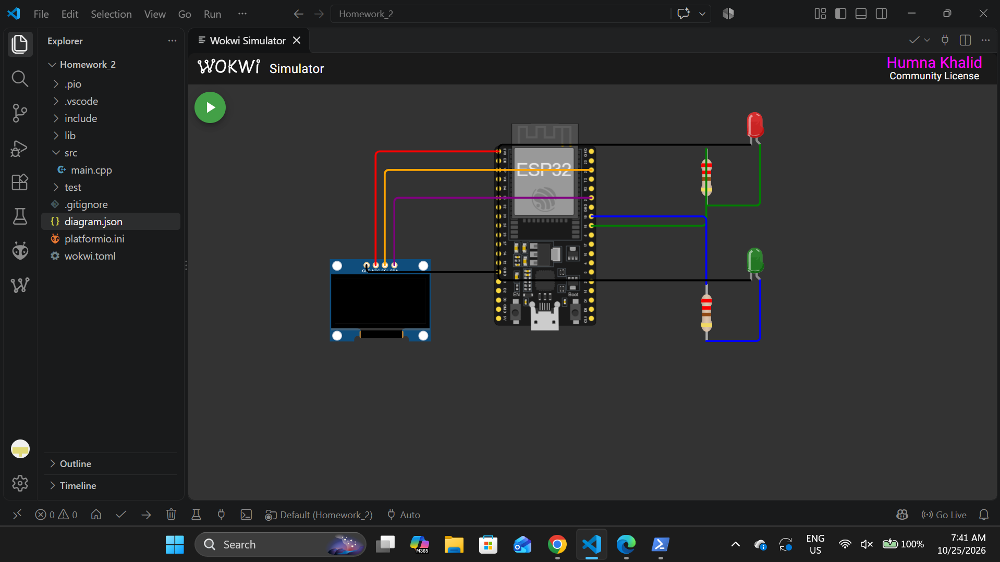
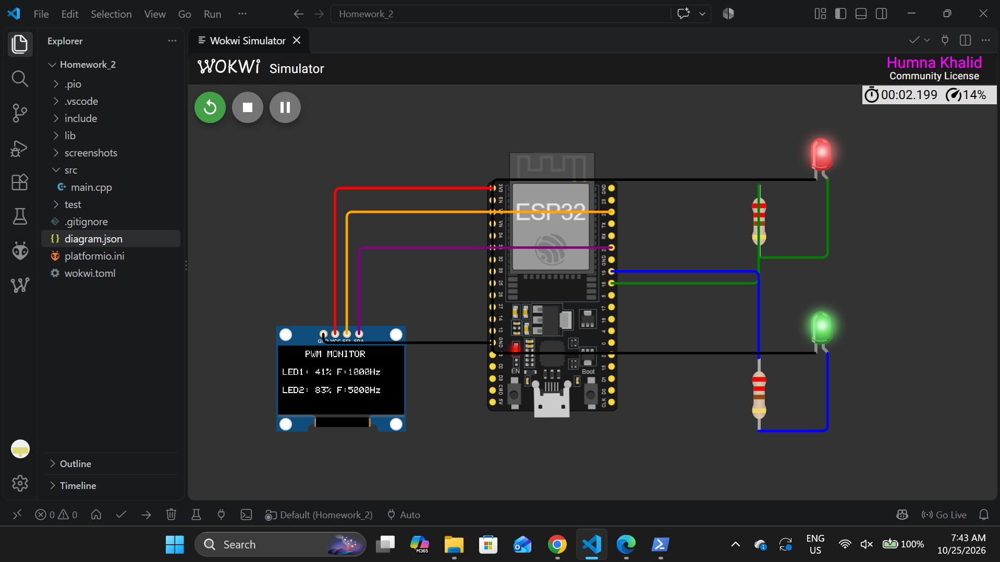
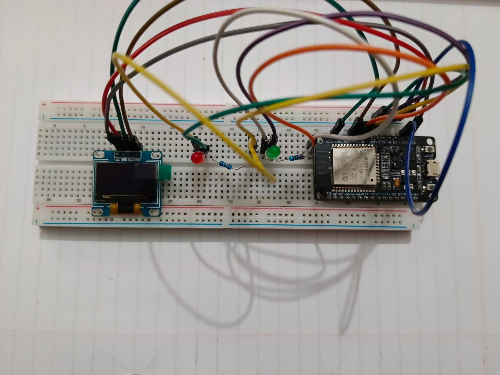
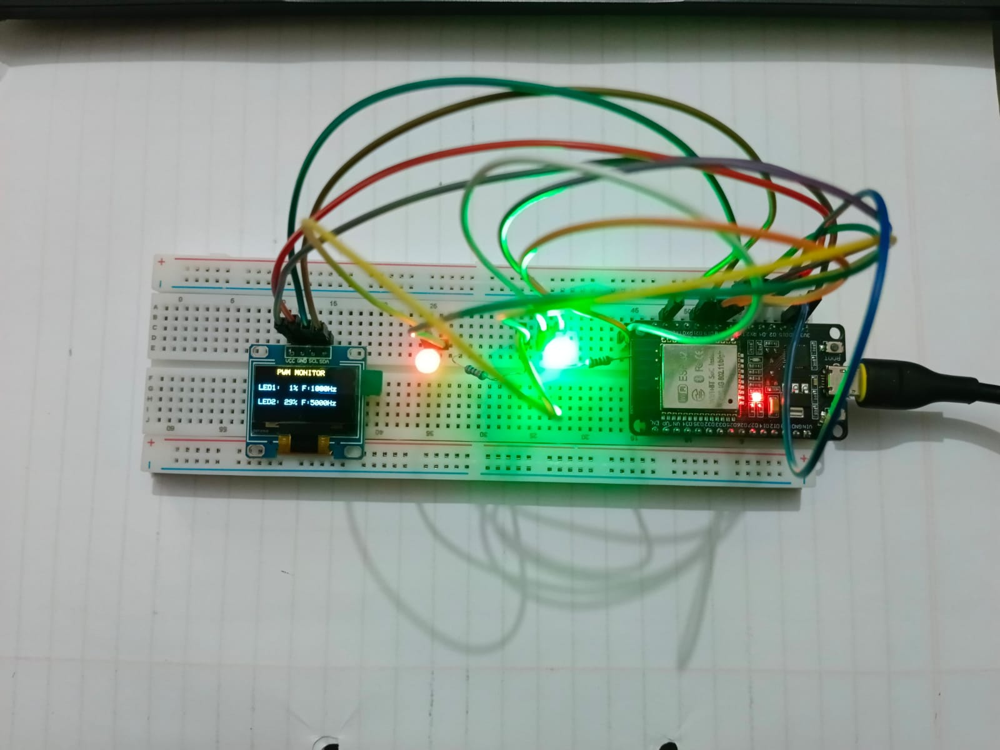

# Homework 2: Dual-LED PWM Control with OLED Monitoring

**Course:** Embedded IoT Systems
**Board:** ESP32 DevKit (ESP32-WROOM-32)
**Framework:** Arduino (PlatformIO), Arduino-ESP32 core 2.x (`platform = espressif32@6.5.0`)

Two LEDs are faded smoothly from minimum to maximum brightness and back using the ESP32 LEDC peripheral, each at a **different PWM frequency**. An SSD1306 I2C OLED shows the live duty cycle (%) and configured frequency of each LED.

## Links

- **Wokwi project:** https://wokwi.com/projects/478826065949880321

## Project structure

```
Homework_2/
├── diagram.json
├── wokwi.toml
├── platformio.ini
├── src/
│   └── main.cpp
├── screenshots/
│   ├── wokwi_circuit.png
│   ├── wokwi_running_oled.png
│   ├── hardware_circuit.jpeg
│   └── hardware_oled_output.jpeg
└── README.md
```

## Wiring

- **LED 1 (red):** GPIO 18, then 220 ohm resistor, then LED anode. LED cathode goes to GND.
- **LED 2 (green):** GPIO 19, then 220 ohm resistor, then LED anode. LED cathode goes to GND.
- **OLED SDA:** GPIO 21
- **OLED SCL:** GPIO 22
- **OLED VCC:** 3V3
- **OLED GND:** GND

Each LED has its own current-limiting resistor (220 ohm). The OLED runs from 3.3 V with I2C address `0x3C`.

## PWM configuration

**LED 1 (red)**
- GPIO: 18
- LEDC channel: 0
- Frequency: 1000 Hz
- Resolution: 8 bit (duty 0 to 255)
- Fade step per 10 ms: 1

**LED 2 (green)**
- GPIO: 19
- LEDC channel: 2
- Frequency: 5000 Hz
- Resolution: 8 bit (duty 0 to 255)
- Fade step per 10 ms: 2

**Why 8-bit resolution:** 256 brightness levels are enough for a smooth visible fade, and it is well within the limit at 5000 Hz (the 80 MHz LEDC timer clock allows up to about 13 bits at 5 kHz). It also keeps the percentage conversion simple.

### LEDC timer sharing 

The ESP32 has 16 LEDC channels but only 4 timers per speed group, and channels share timers. Two channels that use the same timer must use the same frequency. In the Arduino-ESP32 2.x core, channels are paired onto timers (0 and 1 share a timer, 2 and 3 share the next one, and so on). If LED 2 had used channel 1, `ledcSetup()` would have changed the shared timer and both LEDs would have ended up at the same frequency.

To avoid this limitation, **LED 1 uses channel 0 and LED 2 uses channel 2**. They sit on different timers, so 1000 Hz and 5000 Hz run independently.

## How duty cycle control works

- One variable per LED (`redDuty`, `greenDuty`) holds the duty value (0 to 255).
- Every 10 ms, `fadeStep()` moves each duty value up or down by its step and reverses direction at 0 and 255.
- The same variable is written to the PWM channel with `ledcWrite()` and used to draw the OLED, so the display always matches the real output.
- The percentage shown is `duty * 100 / 255`.
- The OLED is refreshed every 100 ms. Timing uses `millis()` (no blocking `delay()`), so fading and display updates run independently.
- The two LEDs fade at different speeds (step 1 and step 2), so they are clearly independent.

## OLED output

```
   PWM MONITOR
LED1: 41% F:1000Hz
LED2: 83% F:5000Hz
```

Values change continuously as the LEDs fade. Frequencies are the configured constants `RED_FREQ` and `GREEN_FREQ`.

## PWM theory 

**Duty cycle and brightness:** PWM switches the LED fully on and off very quickly. The duty cycle is the fraction of each period the output is HIGH. A higher duty gives a higher average voltage and current through the LED, so it appears brighter. At 0% the LED is off and at 100% it is fully on. Human vision perceives brightness non-linearly, so the visible change is faster at low duty values than at high ones.

**Frequency:** Frequency is how many on/off cycles happen per second. It does not change average brightness, it changes the shape of the signal. At low frequencies (a few tens of Hz) flicker becomes visible. At 1 kHz and 5 kHz the eye sees steady light, and the higher frequency has shorter pulses. Higher frequency also reduces the maximum available duty resolution.

## Test results

### Wokwi simulation

- Both LEDs fade up and down continuously.
- OLED shows changing percentages for LED 1 (1000 Hz) and LED 2 (5000 Hz).
- Sample reading from the screenshot: LED1 = 41% at 1000 Hz, LED2 = 83% at 5000 Hz.




### Physical hardware

- Both LEDs fade, and the OLED shows live duty cycles with the configured frequencies.
- Sample reading from the photo: LED1 = 1% at 1000 Hz, LED2 = 29% at 5000 Hz.
- OLED values changed continuously and matched the LED brightness. No flicker was visible at 1 kHz or 5 kHz.
- LED 2 uses a faster fade step, so its percentage changes quicker than LED 1.




## Wokwi vs hardware comparison

- **Behaviour:** Same in both. Both LEDs fade and the OLED updates.
- **LED brightness:** Ideal and smooth in Wokwi. On hardware the brightness looks non-linear, and low duty values are already visible.
- **Wiring:** Clean wires in the Wokwi diagram. Breadboard with jumper wires on hardware, using the same GPIOs.
- **OLED:** Address 0x3C works in both. The pin order on the physical module is VCC, GND, SCL, SDA, which differs from the Wokwi OLED (GND, VCC, SCL, SDA), so the wires were checked carefully.
- **Timing:** Wokwi runs at a percentage of real time, so the fade can look slower. Hardware runs in real time with an exact 10 ms fade step.

The code is the same for both. Only the physical wiring and component tolerances differ.

## Build and run

1. Open the `Homework_2` folder in VS Code with PlatformIO.
2. Build (tick icon). The libraries `Adafruit SSD1306` and `Adafruit GFX Library` are installed automatically from `platformio.ini`.
3. For simulation: open `diagram.json` and press Play.
4. For hardware: connect the ESP32 over USB and press Upload.

## Git history

```
complete homework
task1 completed
```
